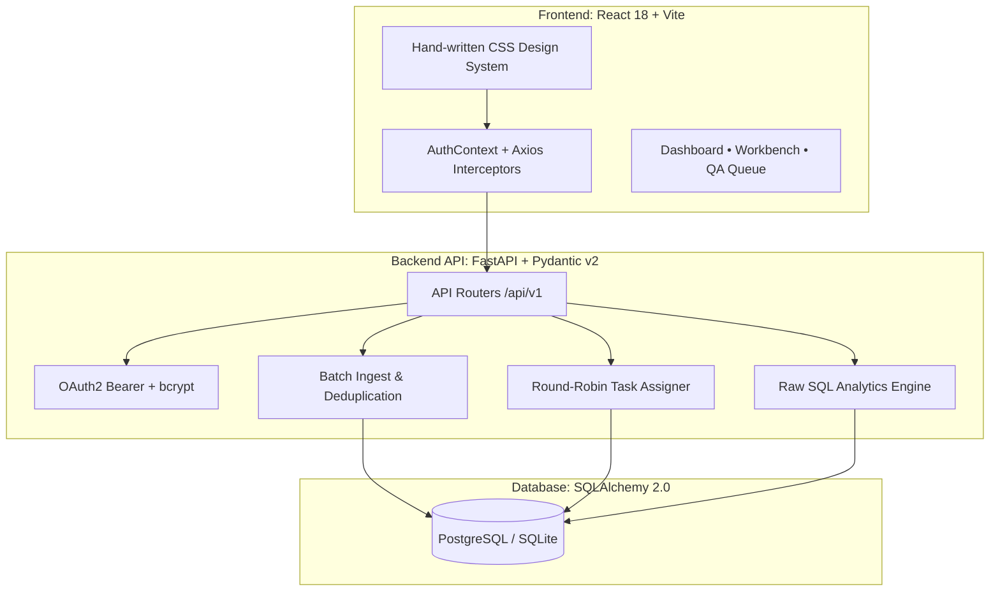

# LabelForge 🏷️
### Enterprise Full-Stack Collaborative Data Annotation Platform (Mini Label Studio)

[](https://github.com)
[](https://www.python.org/)
[](https://fastapi.tiangolo.com)
[](https://react.dev/)
[](https://vitejs.dev/)
[](https://www.sqlalchemy.org/)
[](https://www.postgresql.org/)
[](https://www.docker.com/)
[](https://docs.pytest.org)
[](LICENSE)

---

## 🌟 Executive Summary

**LabelForge** is a production-grade, full-stack data annotation and dataset curation platform engineered from scratch for Machine Learning and Data Science teams. Inspired by industry standards like *Label Studio*, LabelForge bridges the gap between raw uncurated text and high-accuracy supervised training datasets.

Designed to demonstrate modern software engineering craftsmanship, LabelForge showcases:
- **No Heavy UI Kits**: 100% hand-written, modular CSS using CSS custom properties (variables), Flexbox, Grid, and a dual **Light / Obsidian Dark Theme**.
- **Dual ORM & Raw SQL Architecture**: Standard CRUD operations powered by **SQLAlchemy 2.0** ORM alongside **parameterized Raw SQL** for complex multi-table analytical aggregations.
- **Enterprise Role-Based Access Control (RBAC)**: Strict permission boundaries separating **Admins**, **Annotators**, and **Reviewers** with self-review bias prevention.
- **High-Throughput Ergonomics**: Single-key vanilla JS shortcuts (`1`–`9`, `Enter`), automatic queue advancement, and rejection feedback banners.
- **Production DevOps**: Multi-stage Dockerfiles, Docker Compose (Nginx + React + FastAPI + PostgreSQL), and an automated GitHub Actions CI pipeline running 22 pytest tests.

---

## 🏗️ System Architecture & Workflow



### Task Lifecycle State Machine

```
              +------------------------------------------+
              |                                          |
              v                                          | (Annotator fixes)
+---------+       +-------------+       +-----------+       +-------------+
| PENDING | ----> | IN_PROGRESS | ----> | SUBMITTED | ----> |  REJECTED   |
+---------+       +-------------+       +-----------+       +-------------+
                         |                    |
                         |                    v
                         |             +-------------+
                         +-----------> |  APPROVED   | ===> ML-Ready Dataset Export
                                       +-------------+
```

---

## ⚡ Tech Stack Breakdown

| Layer | Technologies | Architectural Justification |
| :--- | :--- | :--- |
| **Frontend SPA** | React 18, Vite, React Router v6 | Sub-second HMR, optimized tree-shaken production bundles, declarative routing. |
| **State & Auth** | Context API, Axios Interceptors | JWT stored in-memory + localStorage with automated token injection and 401 handling. |
| **Styling** | Hand-written CSS (CSS Variables) | Shows core CSS proficiency (Grid, Flexbox, responsive tokens, zero Tailwind/Bootstrap). |
| **Visualizations**| Recharts | Class distribution bar charts and 14-day trailing throughput velocity line charts. |
| **Backend REST** | FastAPI, Python 3.11+, Uvicorn | High-performance async runtime with automated OpenAPI / Swagger generation. |
| **Validation** | Pydantic v2 | Strict request/response schemas, type coercion, and input sanitization. |
| **ORM / Data** | SQLAlchemy 2.0 | Clean repository abstractions, foreign keys with strict cascade/restrict behaviors. |
| **Analytics** | Raw Parameterized SQL | Advanced conditional aggregations (`CASE WHEN`), multi-table joins, and temporal grouping. |
| **Security** | `python-jose` (JWT) + `passlib` (bcrypt) | Stateless authentication, salted password hashing, and role-based guards. |
| **Automated QA** | `pytest`, `TestClient` | 22 comprehensive integration tests running against an isolated in-memory SQLite DB. |
| **DevOps** | Docker, Docker Compose, Nginx | Multi-stage production containerization and GitHub Actions continuous integration. |

---

## 🚀 Key Features

### 1. 👥 Multi-Tenant Role-Based Access Control (RBAC)
- **Admin**: Create & manage projects, define custom colored label schemas, upload raw datasets, assign tasks in round-robin, inspect live analytics, and export verified datasets.
- **Annotator**: View **only** tasks assigned to them; ergonomic keyboard labeling with immediate auto-advance; instant notification banners on reviewer-rejected tasks.
- **Reviewer**: Inspect submitted annotations across all projects; approve or reject with **compulsory feedback**; strict database & API constraints preventing self-review bias.

### 2. ⚡ Ergonomic Labeling Workbench
- Label text in milliseconds using numeric keys <kbd>1</kbd>–<kbd>9</kbd> and <kbd>Enter</kbd> to submit.
- Integrated **Classification Guidelines Drawer** with positive, negative (sarcasm warnings), and neutral examples.
- Auto-advance to the next pending or rejected item in sequence without mouse dependency.

### 3. 🔍 Conflict-Free QA Review Queue
- Reviewers evaluate text context alongside applied category tags.
- One-click approval (<kbd>A</kbd>) or rejection (<kbd>R</kbd>) with required actionable comments.
- Rejected tasks instantly transition back to `IN_PROGRESS` on the original annotator's board.

### 4. 📊 Raw SQL Analytics Engine (No ORM Bloat)
Live analytical metrics computed via parameterized raw SQL queries (`app/sql/queries.py`):
1. **Progress Breakdown**: Single-pass conditional aggregation (`SUM(CASE WHEN ...)`).
2. **Annotator Accuracy Rate**: Multi-table inner joins calculating `Approved / (Approved + Rejected)`.
3. **Class Distribution**: Left outer join preserving zero-count classes for approved records.
4. **14-Day Throughput Velocity**: Date truncation and grouping over a trailing sliding window.

### 5. 🌓 Obsidian Black / Clean Light Theme
- Fully responsive theme toggle with persistence in `localStorage`.
- Built on semantic CSS variables ensuring zero washed-out text and full WCAG AA contrast.

---

## 🔑 Pre-Seeded Demo Credentials

The platform includes a database seeder (`seed.py`) with 200 realistic customer feedback items:

| Role | Email | Password | Pre-loaded Capabilities |
| :--- | :--- | :--- | :--- |
| **👑 Admin** | `admin@labelforge.com` | `admin123` | Full dashboard, project manager, upload, assign, and export |
| **✏️ Annotator 1** | `annotator1@labelforge.com` | `annotator123` | Assigned pending and in-progress tasks ready for labeling |
| **✏️ Annotator 2** | `annotator2@labelforge.com` | `annotator123` | Assigned rejected tasks showing reviewer feedback banners |
| **✏️ Annotator 3** | `annotator3@labelforge.com` | `annotator123` | Additional annotator queue |
| **🔍 Reviewer 1** | `reviewer1@labelforge.com` | `reviewer123` | 40 submitted annotations ready for QA approval/rejection |
| **🔍 Reviewer 2** | `reviewer2@labelforge.com` | `reviewer123` | Additional reviewer QA access |

> [!NOTE]
> The Login page features **One-Click Demo Login** buttons for instant role switching without typing credentials.

---

## 🏁 Quickstart Guide

### Option 1: One-Click Windows Launch (Recommended for Local Dev)

From the project root directory in your VS Code terminal:
```cmd
.\run_all.bat
```
- **Backend API**: `http://localhost:8000` (Interactive Docs: `http://localhost:8000/docs`)
- **Frontend SPA**: `http://localhost:5173`

---

### Option 2: Manual Step-by-Step Setup

#### Backend Setup:
```bash
cd labelforge/backend
python -m venv venv

# Windows:
.\venv\Scripts\activate
# Linux/macOS:
source venv/bin/activate

pip install -r requirements.txt
cp .env.example .env
python seed.py
uvicorn app.main:app --reload --port 8000
```

#### Frontend Setup:
```bash
cd labelforge/frontend
npm install
npm run dev
```

---

### Option 3: Production Docker Compose (PostgreSQL)

Run the complete multi-container stack (React + FastAPI + PostgreSQL + Nginx) with a single command:

```bash
cd labelforge
docker compose up --build -d
```

- **Frontend Application**: `http://localhost` (Port 80)
- **Backend API Docs**: `http://localhost:8000/docs`
- **PostgreSQL Database**: `localhost:5432`

Seed database inside Docker:
```bash
docker compose exec backend python seed.py
```

---

## 🧪 Automated Testing Suite

LabelForge includes 22 automated integration tests running against an isolated in-memory SQLite database:

```bash
cd labelforge/backend
pytest -v
```

```text
============================= test session starts =============================
collected 22 items

tests/test_auth.py ........                           [ 36%]
tests/test_projects_and_upload.py ........            [ 72%]
tests/test_stats_and_export.py ..                     [ 81%]
tests/test_workflow.py ....                           [100%]

======================= 22 passed, 3 warnings in 12.67s =======================
```

### Test Coverage Highlights:
- **Authentication**: Password hashing, JWT claims, role-based 403 access control, duplicate registration rejection.
- **Batch Ingestion**: CSV/JSON parsers, 5,000-row cap, whitespace trimming, and duplicate deduplication.
- **Workflow State Engine**: Full cycle test: Assign &rarr; Annotate &rarr; Reject &rarr; Re-annotate &rarr; Approve.
- **Anti-Bias Verification**: Ensures reviewers cannot review their own submissions.
- **SQL Analytics Validation**: Compares raw SQL outputs against known seeded data values.
- **Dataset Export**: Verifies that only `APPROVED` records are exported in CSV/JSON.

---

## 📡 REST API Reference

All endpoints are prefixed with `/api/v1` and document response schemas in Swagger UI:

| Method | Endpoint | Access | Description |
| :--- | :--- | :--- | :--- |
| `POST` | `/auth/register` | Public | Create new contributor account (Annotator/Reviewer) |
| `POST` | `/auth/login` | Public | Authenticate and obtain JWT Bearer token |
| `GET` | `/users/me` | Authenticated | Retrieve current user profile and role |
| `GET` | `/users` | Admin | Filter active users by role |
| `POST` | `/projects` | Admin | Create new annotation project |
| `GET` | `/projects` | Authenticated | List all active projects |
| `POST` | `/projects/{id}/labels` | Admin | Add label with hex color to project |
| `POST` | `/projects/{id}/upload` | Admin | Upload CSV/JSON text items (max 5,000 rows) |
| `POST` | `/projects/{id}/assign` | Admin | Round-robin distribute unassigned tasks |
| `GET` | `/projects/{id}/stats` | Admin | Execute raw SQL analytical queries |
| `GET` | `/projects/{id}/export` | Admin | Stream approved dataset as CSV or JSON |
| `GET` | `/tasks/my` | Annotator | Paginated list of tasks filtered by status |
| `GET` | `/tasks/{id}` | Authenticated | Retrieve task content and review history |
| `POST` | `/tasks/{id}/annotate`| Annotator | Apply label and advance status to `SUBMITTED` |
| `GET` | `/reviews/queue` | Reviewer | Retrieve submitted tasks pending QA review |
| `POST` | `/tasks/{id}/review` | Reviewer | Submit `APPROVED` or `REJECTED` decision with comment |

---

## 📂 Project Structure

```text
labelforge/
├── backend/
│   ├── app/
│   │   ├── main.py              # FastAPI app lifecycle & middleware
│   │   ├── config.py            # Pydantic BaseSettings (.env loader)
│   │   ├── database.py          # SQLAlchemy 2.0 engine & session maker
│   │   ├── models.py            # ORM entities (User, Task, Project, etc.)
│   │   ├── schemas.py           # Pydantic v2 DTOs & validation models
│   │   ├── auth.py              # JWT generation, bcrypt, require_role()
│   │   ├── routers/             # Modular endpoint routers
│   │   ├── services/            # Ingestion, round-robin, export services
│   │   └── sql/                 # Parameterized Raw SQL analytical queries
│   ├── tests/                   # 22 integration tests with SQLite fixtures
│   ├── seed.py                  # Database seeder (200 realistic items)
│   ├── schema.sql               # Pure SQL DDL schema definitions
│   ├── requirements.txt         # Pinned lean Python dependencies
│   └── Dockerfile               # Multi-stage Python backend image
├── frontend/
│   ├── src/
│   │   ├── api/client.js        # Axios instance with Bearer interceptors
│   │   ├── context/AuthContext  # Global authentication & user state
│   │   ├── components/          # Navbar, Modal, Toast, LoadingSpinner
│   │   ├── pages/               # Landing, Workbench, QA Queue, Dashboard
│   │   └── styles/              # Handwritten CSS tokens & global styles
│   ├── index.html               # Semantic HTML5 shell with theme script
│   ├── nginx.conf               # Production Nginx SPA reverse proxy
│   └── Dockerfile               # Multi-stage frontend build container
├── docs/                        # Complete SDLC Documentation Suite
│   ├── SRS.md                   # Software Requirements Specification
│   ├── DESIGN.md                # Architecture, ER & State Diagrams
│   ├── TESTING.md               # Test Plan and 22-case validation matrix
│   ├── CONTRIBUTING.md          # Branching model & Conventional Commits
│   └── CHANGELOG.md             # Semantic release history (v0.1 to v1.0)
├── docker-compose.yml           # Full-stack composition (App + DB)
└── README.md                    # Primary repository documentation
```

---

## 📚 SDLC Documentation Suite

For deep architectural and implementation details, explore the dedicated `/docs` directory:
- [SRS.md](labelforge/docs/SRS.md) — 16 Gherkin User Stories with acceptance criteria.
- [DESIGN.md](labelforge/docs/DESIGN.md) — Comprehensive ER diagrams, architectural choices, and API definitions.
- [TESTING.md](labelforge/docs/TESTING.md) — Testing strategy, test cases matrix, and fixture lifecycle.
- [CONTRIBUTING.md](labelforge/docs/CONTRIBUTING.md) — Git workflow, branch naming conventions, and commit standards.
- [CHANGELOG.md](labelforge/docs/CHANGELOG.md) — Release notes and milestone breakdown.

---

## 📄 License

This project is licensed under the MIT License — see the [LICENSE](LICENSE) file for details.
