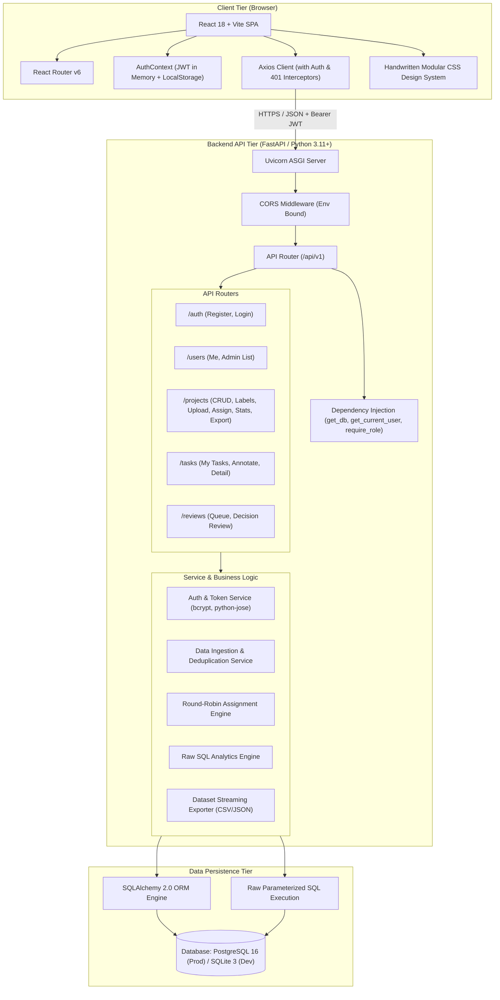
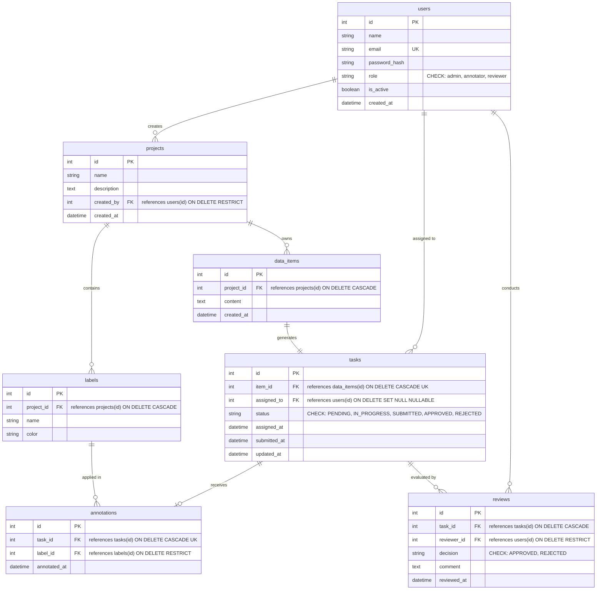
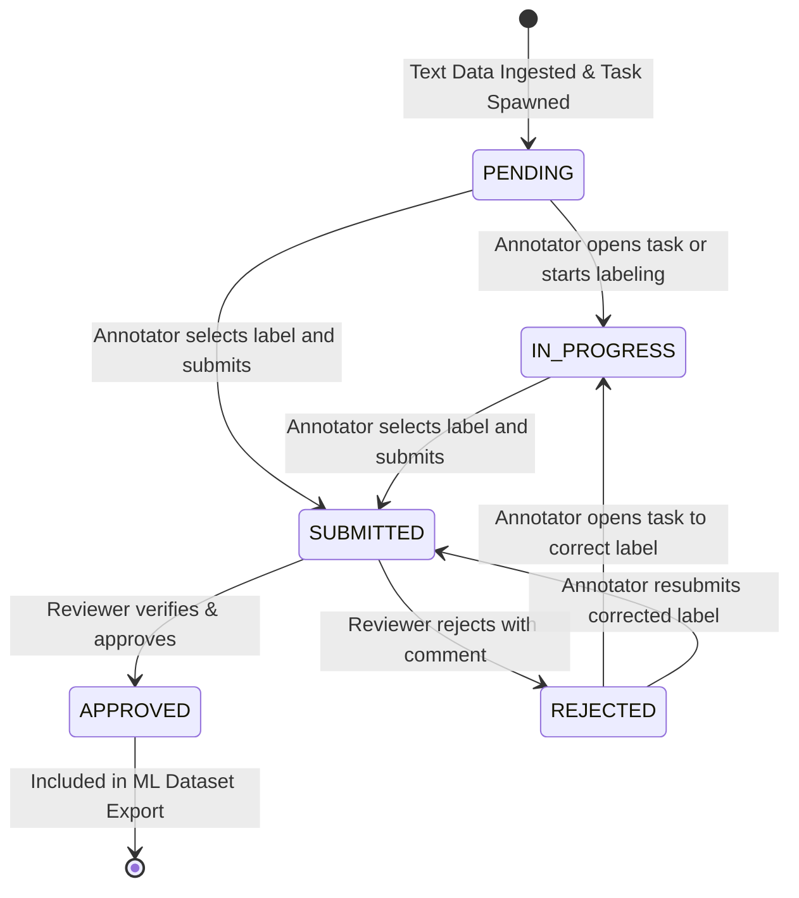

# System Architecture & Design Specification
## Project Name: LabelForge

---

### 1. High-Level System Architecture

LabelForge follows a clean, decoupled client-server architecture consisting of a Single Page Application (SPA) frontend, an asynchronous REST API backend, and a relational database tier.



---

### 2. Database Entity-Relationship (ER) Diagram



#### Key Schema Constraints & Indexes:
1. `labels`: `UNIQUE (project_id, name)` prevents duplicate label names within a single project.
2. `tasks`: `UNIQUE (item_id)` ensures a 1:1 mapping between ingested data items and tasks.
3. `tasks`: `INDEX idx_tasks_assigned_status ON tasks (assigned_to, status)` accelerates annotator workbench filtering and dashboard aggregation queries.
4. `data_items`: `INDEX idx_data_items_project ON data_items (project_id)` optimizes batch project queries and dataset exports.
5. `annotations`: `UNIQUE (task_id)` enforces a single active annotation per task.
6. `reviews`: `task_id` has a foreign key to `tasks(id) ON DELETE CASCADE` while maintaining an audit trail of review decisions.

---

### 3. Task Status Lifecycle & State Diagram

The lifecycle of an annotation task follows a deterministic finite-state machine (FSM). Any unauthorized or invalid transition produces an `HTTP 409 Conflict`.



#### State Transition Rules:
- An annotator can only modify tasks in `PENDING`, `IN_PROGRESS`, or `REJECTED` state.
- Transition from `PENDING` or `IN_PROGRESS` to `SUBMITTED` requires assigning a valid `label_id` belonging to the task's project.
- A reviewer can only transition tasks from `SUBMITTED` to `APPROVED` or `REJECTED`.
- Transitioning to `REJECTED` mandates a non-empty `comment`.
- Self-review is strictly blocked: if `task.assigned_to == current_user.id`, the transition is aborted with `HTTP 403 Forbidden`.

---

### 4. REST API Endpoint Specification

All endpoints are prefixed with `/api/v1`. Consistent JSON error schemas are returned:
```json
{
  "detail": "Error description message"
}
```

| Domain | Method | Endpoint | Role(s) | Request Body | Success Response | Status Codes |
| :--- | :--- | :--- | :--- | :--- | :--- | :--- |
| **Auth** | `POST` | `/auth/register` | Public | `UserRegisterSchema` (`name`, `email`, `password`) | `UserResponseSchema` (id, name, email, role, created_at) | 201, 400, 409, 422 |
| **Auth** | `POST` | `/auth/login` | Public | `OAuth2PasswordRequestForm` (`username` [email], `password`) | `TokenSchema` (`access_token`, `token_type`, `user`) | 200, 401, 422 |
| **Users** | `GET` | `/users/me` | Any Authenticated | None | `UserResponseSchema` | 200, 401 |
| **Users** | `GET` | `/users` | `admin` | Query: `role` (optional) | `List[UserResponseSchema]` | 200, 401, 403 |
| **Projects** | `POST` | `/projects` | `admin` | `ProjectCreateSchema` (`name`, `description`) | `ProjectDetailSchema` | 201, 400, 401, 403, 422 |
| **Projects** | `GET` | `/projects` | Any Authenticated | Query: `page`, `limit` | `PaginatedResponse[ProjectSummarySchema]` | 200, 401 |
| **Projects** | `GET` | `/projects/{id}` | Any Authenticated | None | `ProjectDetailSchema` (includes labels, counts) | 200, 401, 404 |
| **Projects** | `PUT` | `/projects/{id}` | `admin` | `ProjectUpdateSchema` (`name`, `description`) | `ProjectDetailSchema` | 200, 400, 401, 403, 404, 422 |
| **Projects** | `DELETE` | `/projects/{id}` | `admin` | None | `{ "message": "Project deleted successfully" }` | 200, 401, 403, 404 |
| **Labels** | `POST` | `/projects/{id}/labels` | `admin` | `LabelCreateSchema` (`name`, `color`) | `LabelResponseSchema` | 201, 400, 401, 403, 404, 409, 422 |
| **Labels** | `GET` | `/projects/{id}/labels` | Any Authenticated | None | `List[LabelResponseSchema]` | 200, 401, 404 |
| **Labels** | `DELETE`| `/labels/{id}` | `admin` | None | `{ "message": "Label deleted successfully" }` | 200, 401, 403, 404 |
| **Upload** | `POST` | `/projects/{id}/upload` | `admin` | `multipart/form-data` with `file` (.csv or .json) | `UploadSummarySchema` (`inserted`, `skipped`, `total_processed`) | 201, 400, 401, 403, 404, 422 |
| **Assign** | `POST` | `/projects/{id}/assign` | `admin` | `AssignTasksSchema` (`annotator_ids: List[int]`) | `AssignResultSchema` (`assigned_count`, `distribution`) | 200, 400, 401, 403, 404, 422 |
| **Tasks** | `GET` | `/tasks/my` | `annotator`, `admin` | Query: `status`, `page`, `limit` | `PaginatedResponse[TaskListItemSchema]` | 200, 401, 403 |
| **Tasks** | `GET` | `/tasks/{id}` | Any Authenticated | None | `TaskDetailSchema` (item text, current label, latest review comment) | 200, 401, 403, 404 |
| **Tasks** | `POST` | `/tasks/{id}/annotate` | `annotator`, `admin` | `AnnotateTaskSchema` (`label_id: int`) | `TaskDetailSchema` | 200, 400, 401, 403, 404, 409, 422 |
| **Reviews**| `GET` | `/reviews/queue` | `reviewer`, `admin` | Query: `project_id` (optional), `page`, `limit` | `PaginatedResponse[ReviewQueueItemSchema]` | 200, 401, 403 |
| **Reviews**| `POST` | `/tasks/{id}/review` | `reviewer`, `admin` | `ReviewSubmitSchema` (`decision: "APPROVED"|"REJECTED"`, `comment: Optional[str]`) | `ReviewResponseSchema` | 200, 400, 401, 403, 404, 409, 422 |
| **Stats** | `GET` | `/projects/{id}/stats` | `admin`, `reviewer` | None | `ProjectStatsSchema` (progress, annotator_accuracy, label_distribution, daily_throughput) | 200, 401, 403, 404 |
| **Export** | `GET` | `/projects/{id}/export`| `admin` | Query: `format=csv\|json` | Streamed File Download (`text/csv` or `application/json`) | 200, 400, 401, 403, 404 |

---

### 5. Raw SQL Analytics Specification

The analytics engine uses raw parameterized SQL queries executed via SQLAlchemy's `session.execute(text(query), {"project_id": ...})` rather than ORM abstractions. This demonstrates advanced SQL capabilities and guarantees predictable query performance.

#### Query 1: Progress Breakdown (Conditional Aggregation)
```sql
-- SQL Concept: Conditional Aggregation (SUM with CASE WHEN) to pivot status counts in a single table scan
SELECT
    COUNT(*) AS total_tasks,
    COALESCE(SUM(CASE WHEN t.status = 'PENDING' THEN 1 ELSE 0 END), 0) AS pending_count,
    COALESCE(SUM(CASE WHEN t.status = 'IN_PROGRESS' THEN 1 ELSE 0 END), 0) AS in_progress_count,
    COALESCE(SUM(CASE WHEN t.status = 'SUBMITTED' THEN 1 ELSE 0 END), 0) AS submitted_count,
    COALESCE(SUM(CASE WHEN t.status = 'APPROVED' THEN 1 ELSE 0 END), 0) AS approved_count,
    COALESCE(SUM(CASE WHEN t.status = 'REJECTED' THEN 1 ELSE 0 END), 0) AS rejected_count,
    ROUND(
        CASE 
            WHEN COUNT(*) = 0 THEN 0.0
            ELSE (CAST(SUM(CASE WHEN t.status = 'APPROVED' THEN 1 ELSE 0 END) AS FLOAT) / COUNT(*)) * 100.0
        END, 2
    ) AS completion_percentage
FROM tasks t
JOIN data_items di ON t.item_id = di.id
WHERE di.project_id = :project_id;
```

#### Query 2: Annotator Accuracy (Multi-table JOIN and Aggregation)
```sql
-- SQL Concept: Inner Joins with GROUP BY and conditional ratio calculations to evaluate quality per user
SELECT
    u.id AS user_id,
    u.name AS annotator_name,
    COUNT(r.id) AS total_reviewed,
    COALESCE(SUM(CASE WHEN r.decision = 'APPROVED' THEN 1 ELSE 0 END), 0) AS approved_count,
    COALESCE(SUM(CASE WHEN r.decision = 'REJECTED' THEN 1 ELSE 0 END), 0) AS rejected_count,
    ROUND(
        CASE 
            WHEN COUNT(r.id) = 0 THEN 0.0
            ELSE (CAST(SUM(CASE WHEN r.decision = 'APPROVED' THEN 1 ELSE 0 END) AS FLOAT) / COUNT(r.id)) * 100.0
        END, 2
    ) AS accuracy_percentage
FROM tasks t
JOIN data_items di ON t.item_id = di.id
JOIN users u ON t.assigned_to = u.id
JOIN reviews r ON r.task_id = t.id
WHERE di.project_id = :project_id
GROUP BY u.id, u.name
ORDER BY accuracy_percentage DESC;
```

#### Query 3: Label Distribution for Approved Tasks (JOIN with Categorical Grouping)
```sql
-- SQL Concept: Multi-table JOIN with WHERE filtering and GROUP BY to generate class balance metrics
SELECT
    l.id AS label_id,
    l.name AS label_name,
    l.color AS label_color,
    COUNT(a.id) AS approved_count
FROM labels l
LEFT JOIN annotations a ON l.id = a.label_id
LEFT JOIN tasks t ON a.task_id = t.id AND t.status = 'APPROVED'
LEFT JOIN data_items di ON t.item_id = di.id AND di.project_id = :project_id
WHERE l.project_id = :project_id
GROUP BY l.id, l.name, l.color
ORDER BY approved_count DESC;
```

#### Query 4: Daily Submission Throughput (Date Truncation & Temporal Grouping)
```sql
-- SQL Concept: Date formatting/truncation over a bounded time window (last 14 days) to measure velocity
SELECT
    DATE(t.submitted_at) AS submission_date,
    COUNT(*) AS submissions_count
FROM tasks t
JOIN data_items di ON t.item_id = di.id
WHERE di.project_id = :project_id
  AND t.submitted_at IS NOT NULL
  AND t.submitted_at >= DATE('now', '-14 days')
GROUP BY DATE(t.submitted_at)
ORDER BY submission_date ASC;
```
*(Note: In production PostgreSQL, `DATE('now', '-14 days')` is adapted to `CURRENT_DATE - INTERVAL '14 days'`, handled automatically via database-dialect-aware query dispatching).*
